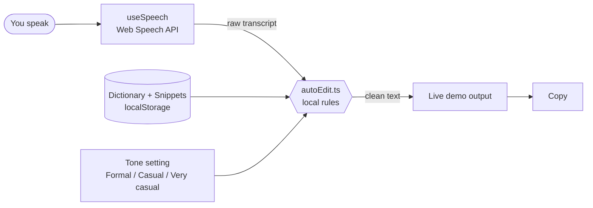

<div align="center">

# 🎙️ Murmur

### Say it once. Read it clean.

*A voice-dictation product site that actually listens.*


[Quick start](#-quick-start) · [What's inside](#-whats-inside) · [How it works](#-how-a-sentence-travels) · [Architecture](#%EF%B8%8F-architecture) · [Limitations](#%EF%B8%8F-honest-limitations)

</div>

---

## ✨ The idea

Murmur is a **concept marketing site for a fictional voice-dictation app**, built in the spirit of modern voice-AI product pages. The twist: the page does not just *describe* dictation, it lets you **try it**. Talk to your browser, watch the filler words disappear, and race your own keyboard.

> Original name, logo, copy and art. No third-party brand assets, testimonials or customer statistics are used. Every number on the page is labelled as illustrative.

## 🚀 Quick start

```bash
npm install
npm run dev        # http://localhost:5173
```

| Command | What it does |
| --- | --- |
| `npm run dev` | Vite dev server with hot reload |
| `npm run build` | Typecheck (`tsc -b`) then production build into `dist/` |
| `npm run preview` | Serve the production build locally |
| `npm run typecheck` | Types only |
| `npm run lint` | ESLint (flat config, React hooks rules) |

Requires **Node 18+**. No API keys, no environment variables, no server.

## 🧭 What's inside

| Section | What works |
| --- | --- |
| **Nav** | Sticky, blurs on scroll, anchor links, mobile menu (Esc closes, closes on link) |
| **Hero** | Animated app window: speech is "heard", then cleaned text types in. Mail / Chat / Editor tabs and a pause button |
| **App strip** | Looping marquee of places you type (pauses on hover) |
| **Live demo** | Real dictation via the browser's Web Speech API (mic only after a click), *Play a sample*, or just type. Tone: Formal / Casual / Very casual. Editable **Dictionary** and **Snippets** (saved in localStorage). Copy button |
| **Speed calculator** | Sliders for your typing speed and words per day vs. a stated 150 wpm speaking pace |
| **Typing test and voice race** | Measure your typing speed and compare it with speaking, with a WPM chart and a live mic-level waveform |
| **Features** | Six cards with before / after examples |
| **Use cases** | Keyboard-accessible tabs (arrow keys, Home / End) |
| **Privacy** | Plain-language breakdown of what runs where |
| **Pricing** | Monthly / yearly toggle; buttons open the waitlist (labelled illustrative) |
| **FAQ** | Accordion |
| **Waitlist** | Native `<dialog>` with validation; the email is stored only in localStorage |

## 🔊 How a sentence travels



The cleanup engine, `src/lib/autoEdit.ts`, is a small, local rule set. **No AI model, no network calls.** It:

- removes fillers and repeated words
- applies quick self-corrections (`"3 no wait 4"`, `"scratch that"`)
- converts spoken punctuation (`"comma"`, `"new paragraph"`)
- expands your snippets and applies your dictionary
- adjusts tone

<details>
<summary><b>See it in action (illustrative)</b></summary>

| You say | Murmur writes |
| --- | --- |
| `um so the meeting is at 3 no wait 4 comma tomorrow` | `The meeting is at 4, tomorrow.` |
| `send it to to the team scratch that send it to Priya` | `Send it to Priya.` |

</details>

## 🏗️ Architecture

```
src/
├── App.tsx              page composition + waitlist state
├── content.ts           all copy and data in one place
├── styles.css           design tokens + section styles
├── lib/
│   ├── autoEdit.ts      cleanup engine (rule based, no network)
│   ├── useSpeech.ts     Web Speech API hook
│   ├── useMicLevel.ts   microphone level for the waveform
│   ├── typing.ts        typing-speed helpers
│   └── hooks.ts         reduced motion, scroll reveal, safe localStorage
└── components/          one file per section (Hero, LiveDemo, Pricing, ...)
```

**Design choices worth knowing**

- **Content lives in `content.ts`.** Changing copy, pricing or FAQ never means touching a component.
- **Only React and fonts at runtime.** No UI kit, no animation library, no state manager.
- **Type:** Inter Variable for UI, Instrument Serif for display, JetBrains Mono for the code-like bits.
- **Design tokens** live in `styles.css`.

| Layer | Choice |
| --- | --- |
| UI | React 18 |
| Language | TypeScript 5 |
| Build | Vite 5 |
| Speech | Browser Web Speech API |
| Storage | `localStorage` through a safe wrapper |
| Lint | ESLint 9 + typescript-eslint + react-hooks |

## ♿ Accessibility and privacy by design

- The microphone starts **only after an explicit click**.
- Tabs support arrow keys, Home and End; Esc closes the mobile menu.
- The waitlist uses a native `<dialog>`, so focus handling and Esc come from the browser.
- A **reduced-motion hook** calms animations for people who ask for it.
- Cleanup runs entirely in your tab. Dictionary, snippets and the waitlist email stay in localStorage.

## 🌐 Browser support

| Browser | Live dictation | Everything else |
| --- | --- | --- |
| Chrome | ✅ | ✅ |
| Edge | ✅ | ✅ |
| Safari | ✅ | ✅ |
| Firefox | ❌ falls back to typing and samples | ✅ |

## ⚠️ Honest limitations

- There is **no desktop app**. The site says so in the hero badge, the FAQ and the pricing section.
- Live dictation needs Chrome, Edge or Safari. Chrome's speech recognition sends audio to Google's servers, and the page discloses this.
- Cleanup rules are English-only and deliberately simple compared with a real AI editor.
- Pricing, plans and the waitlist are illustrative. Nothing is charged.

## 🗺️ Ideas for next

- [ ] Unit tests for `autoEdit.ts`
- [ ] More languages for the cleanup rules
- [ ] Light / dark theme toggle
- [ ] Deploy preview on every pull request

## 🤝 Contributing

Run `npm run lint` and `npm run build` before opening a pull request. Both should pass.

---

<div align="center">

Made with React, a microphone and a low tolerance for "um".

</div>
